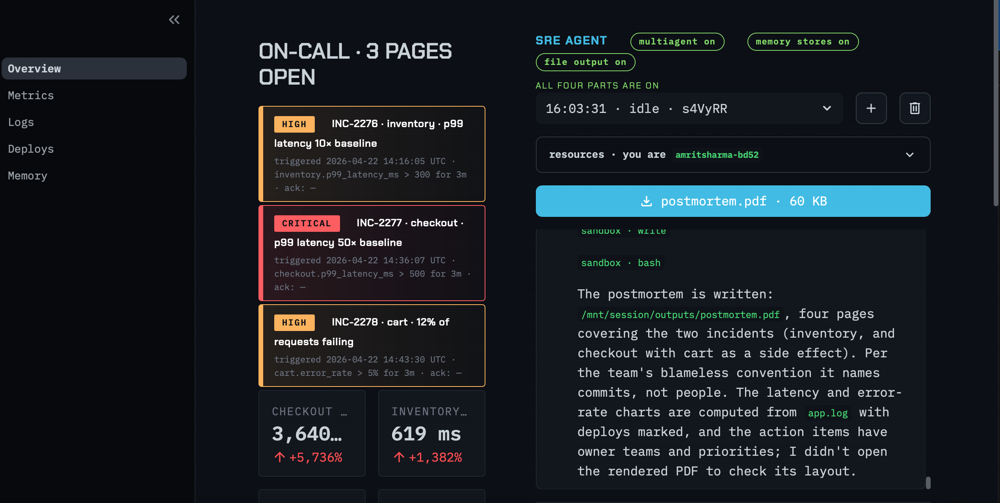
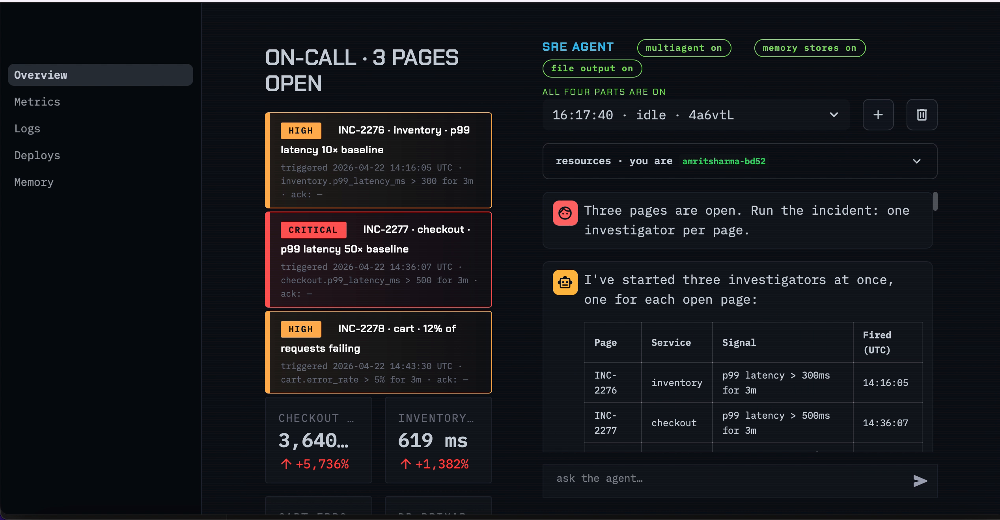

# SRE Incident Agent on Claude Managed Agents

An on-call assistant that investigates production incidents on its own. You ask it *"what caused the latency spike?"*. It searches a 74,000-line log in a cloud sandbox, calls tools on the local machine to pull metrics, deploys and code diffs, assigns one investigator agent per open page, remembers past incidents, and writes a 4-page postmortem PDF.

Built on **[Claude Managed Agents](https://platform.claude.com/docs/en/managed-agents/overview)**, starting from Anthropic's *Ship Your First Managed Agent* workshop ([video](https://www.youtube.com/watch?v=19HDQ9HppOA) · [source](https://github.com/anthropics/cwc-workshops/tree/main/ship-your-first-managed-agent)).



**[Watch the 2.5-minute demo](docs/demo.mp4)** · **[Read the postmortem the agent wrote](docs/postmortem.pdf)**

---

## The scenario

The data describes a fictional e-commerce stack with three pages open at once:

| Page | Service | Alert |
|---|---|---|
| INC-2276 | inventory | p99 latency 10× baseline |
| INC-2277 | checkout | p99 latency 50× baseline (critical) |
| INC-2278 | cart | 12% of requests failing |

The evidence is spread across logs, metrics, deploy history and code diffs, as it would be in a real outage. No single source gives the answer.

## What the agent found

The agent established that the three pages come from **two unrelated incidents**, not three:

- **Incident A (INC-2276).** Commit `c81d4e7` removed the `@cached` decorator from inventory's SKU availability lookup. Inventory p99 went from ~44 ms to ~600 ms.
- **Incident B (INC-2277 + INC-2278).** Commit `a3f9c21`, described as a *"readability refactor,"* turned one batched query into one query per order (an N+1 bug). That produced 30,892 extra queries, filled checkout's 50-connection database pool, and pushed checkout p99 from 69 ms to 3,640 ms. Cart uses the same database, so its errors were a **symptom**, not a separate root cause.

The agent also ruled out the explanations that didn't fit, such as GC pauses, an unrelated inventory deploy, and auth changes. It linked Incident A to a past incident (INC-2190) recorded in team memory, and followed the team's blameless postmortem convention.



## How it works

```
                    Anthropic cloud                          My laptop
 ┌───────────────────────────────────────────────┐   ┌──────────────────────────┐
 │ Commander agent (coordinator)                 │   │ Streamlit dashboard      │
 │   ├─ Investigator thread: INC-2276            │   │                          │
 │   ├─ Investigator thread: INC-2277            │◄──┤ stream_reply()           │
 │   └─ Investigator thread: INC-2278            │──►│   event stream           │
 │                                               │   │                          │
 │ Sandbox container                             │   │ handle_tool()            │
 │   bash / read / write  → greps app.log        │   │   list_incidents         │
 │   /mnt/memory/  team history + notebook       │   │   get_metrics            │
 │   skills: triage runbook, postmortem report   │   │   get_recent_deploys     │
 │   /mnt/session/outputs/postmortem.pdf         │   │   get_diff               │
 └───────────────────────────────────────────────┘   └──────────────────────────┘
```

**Built-in tools** (bash, file read/write) run in Anthropic's sandbox. **Custom tools** run on my machine: the agent requests them over the event stream and my code returns the result. To use this in production, I would swap the mock JSON files in `handle_tool()` for real clients such as Datadog or GitHub.

## Built in four parts

| Part | Feature | Managed Agents concepts |
|---|---|---|
| 1 | One agent that investigates an incident | Agent, Environment, Session, Events, Files API, Skills, custom tools |
| 2 | A team: one investigator per page, in parallel | Multiagent coordinator, threads, pinned agent versions |
| 3 | Memory across sessions | Memory stores: team history (read-only) plus the agent's own notebook (read-write) |
| 4 | A downloadable postmortem PDF | Session outputs, a second skill, Files API download |

### The core functions (`agent.py`)

| Function | What it does |
|---|---|
| `setup_environment()` | Creates the cloud container blueprint once and reuses it |
| `upload_log()` | Uploads `app.log` to the Files API, since the agent can't see local files |
| `setup_skill()` | Publishes a folder of instructions (the team runbook) as a versioned skill |
| `setup_agent()` | Defines the commander: model, system prompt, tools, skills, investigator roster |
| `setup_investigator()` | Defines the sub-agent that works a single page |
| `start_session()` | Combines agent, environment, log file and memory stores into one conversation |
| `stream_reply()` | Sends a message, streams events, and answers custom tool calls by ID |
| `handle_tool()` | Runs the four custom tools locally and returns the results as text |
| `setup_memory()` | Creates and seeds the memory stores |
| `download_outputs()` | Downloads files the agent wrote, such as the PDF |
| `delete_session()` | Removes a session's container and history |

## Design decisions worth noting

- **Idempotent cloud resources.** Each resource goes through `state.sync()`, which creates it once, reuses it on later runs, and creates a new version only when its config changes. Reloading the dashboard never duplicates resources.
- **Versioned agents.** Changing a prompt creates a new version of the same agent. The commander pins a specific investigator version, so editing the investigator can't silently change a running team.
- **Tool errors are reported back to the agent.** A crashing tool handler returns an error message instead of leaving the agent waiting forever. Unknown metric names return the list of valid ones, so the agent can correct itself.
- **Least privilege on memory.** Shared team knowledge is mounted read-only, so the agent can read the team's history without being able to change it.
- **Where I'd tighten for production:** lock down the sandbox's network access (currently unrestricted), and use a cheaper model for investigators while keeping the strongest one as commander.

## How I built it

I worked through the workshop with **Claude Code** as a pair programmer. It wrote the code for each part. I set up the environment, debugged the toolchain, and went through each function to understand it before moving on. The setup took real troubleshooting: missing Xcode command line tools, a Python version too new for a binary dependency, and installer PATH issues. See **[BUILD_LOG.md](docs/BUILD_LOG.md)** for the full log of problems and fixes.

## Run it yourself

Requires Python 3.10–3.13 and an [Anthropic API key](https://console.anthropic.com/settings/keys).

```bash
python3.13 -m venv .venv
source .venv/bin/activate
pip install -r requirements.txt
cp .env.example .env          # add ANTHROPIC_API_KEY
python data/generate_log.py   # generates the 74k-line app.log
streamlit run app.py          # opens http://localhost:8501
```

Running the agent uses API credits. `python cleanup.py` deletes every cloud resource the project created.

## Tech stack

Python 3.13 · Anthropic Python SDK (Claude Managed Agents beta) · Claude Opus · Streamlit · Plotly

## Credits

- **Video:** [Ship your first Managed Agent](https://www.youtube.com/watch?v=19HDQ9HppOA), published by Anthropic on the Claude YouTube channel (May 26, 2026). This workshop taught me the Agent → Environment → Session → Events model this project is built on.
- **Code:** based on [anthropics/cwc-workshops](https://github.com/anthropics/cwc-workshops) (Apache-2.0), © Anthropic PBC. The scenario, mock data, dashboard UI and workshop scaffolding are Anthropic's. I implemented the agent functions in `agent.py` with Claude Code, and did the setup, debugging, documentation and demo myself.
