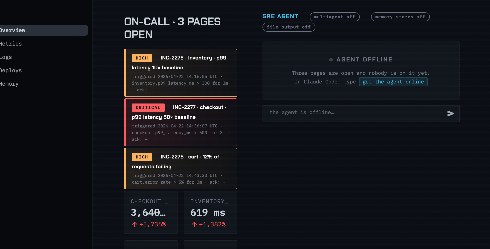
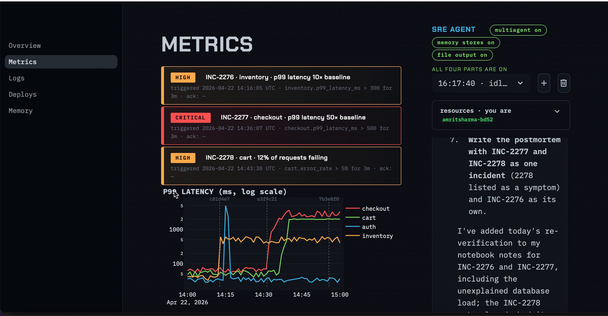

# Build log

What it took to get from a fresh MacBook terminal to a working multi-agent system, including what broke and how I fixed it.

**Date:** November 10, 2026 · **Time:** about 1.5 hours, start to finish · **Machine:** macOS (Intel), bash shell

---

## 1. Toolchain setup

| Step | Problem | Cause | Fix |
|---|---|---|---|
| `python3 --version` | `xcrun: error: invalid active developer path` | Apple's Command Line Tools were missing or broken | `xcode-select --install` |
| Python version | System Python was **3.9.6**; the project needs 3.10+ | Old macOS default | Installed a newer Python from python.org (no Homebrew on this machine) |
| `pip install` on Python **3.15** | `Failed building wheel for pillow`: *headers or library files could not be found for jpeg* | Python 3.15 was too new: Pillow 11.3.0 had no prebuilt wheel for it, so pip tried to compile from source without the image libraries | Switched to a version with prebuilt wheels instead of installing C libraries |
| Picking that version | **3.13.18** offered only source tarballs | It is a security-only release, and those ship without installers | Used **3.13.17**, the last 3.13 release with a macOS installer |
| Rebuild | n/a | n/a | Deleted `.venv`, recreated it with `python3.13 -m venv .venv`, and every dependency installed from wheels |

**Lesson:** the newest runtime isn't always the right one. Check that your heaviest dependencies ship wheels for it.

## 2. Claude Code setup

| Problem | Fix |
|---|---|
| `claude: command not found` right after installing | The installer put the binary in `~/.local/bin`, which wasn't on my `PATH`. Added it to `~/.bash_profile` and re-sourced it. |
| Workshop prompts were going to the wrong place | I typed a question for Claude Code into the **dashboard's agent chat** instead. The agent correctly reported that it couldn't find `agent.py`, because it runs in its own cloud container and only sees what it's given. This showed the sandbox boundary in practice. |

## 3. Building the agent

| Part | What happened |
|---|---|
| **1. One agent** | Eight functions implemented and the test passed. In the first live run, the agent named commit `a3f9c21` as the root cause of INC-2277. |
| **2. Team** | Added an investigator agent and a coordinator roster. The test ran three investigators in parallel and finished in about 100 s. |
| **3. Memory** | The first automated edit failed because the target line also appeared in a code comment, so the match wasn't unique. It was fixed by anchoring the edit to the code line and rerunning. |
| **4. PDF** | The first test run failed with *"a skill with this title already exists."* The running dashboard had hot-reloaded `agent.py` and created the same skill at the same moment as the test script. The skill had been saved correctly, so a rerun passed. |

## 4. Running it

| Problem | Cause | Fix |
|---|---|---|
| Streamlit logged `KeyError: 'provided'` | The dashboard hot-reloaded while `agent.py` was halfway through an edit | Restarted `streamlit run app.py` |

**Lesson:** when a long-running dev server watches the files your tooling is editing, expect race conditions, and restart the server after large changes.

## Final result

- All four parts on: multiagent, memory stores, file output
- Correctly separated three pages into two root causes, and identified the third page as a symptom
- Produced a 4-page postmortem PDF with charts, timelines, evidence and fixes ([postmortem.pdf](postmortem.pdf))
- Demo recording: [demo.mp4](demo.mp4)

